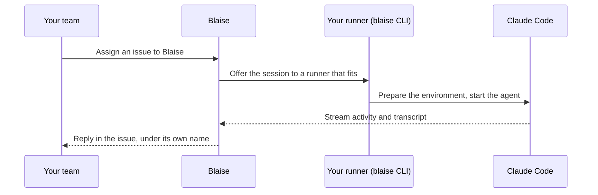

# Blaise

<p align="center">
  
</p>

<p align="center">
  <strong>The skilled AI teammate your organization builds and trusts.</strong><br />
  Present where your work lives. Powered by specialist agents your team configures.<br />
  Running on infrastructure you control.
</p>

<p align="center">
  <a href="https://askblaise.com"><strong>askblaise.com</strong></a> ·
  <a href="https://askblaise.com/docs"><strong>Documentation</strong></a> ·
  <a href="https://askblaise.com/docs/cli"><strong>Get started</strong></a>
</p>

---

## Assign it to Blaise. It will take it from here.

Most AI agents live in one person's terminal: useful to whoever is typing, invisible to everyone
else, and a long way from where the work actually arrives.

Blaise brings the agents your organization trusts into the tools your whole team already uses.
Assign Blaise a Linear issue, or carry on the conversation in its comments. Blaise understands the
request, hands it to the agent configured for that kind of work, and replies under its own name, the
way a capable colleague would.

Your enablement team decides how it works. Everyone else just works with Blaise.

## Why teams choose it

|                                   |                                                                                                                                                                          |
| --------------------------------- | ------------------------------------------------------------------------------------------------------------------------------------------------------------------------ |
| **A teammate, not a tab**         | Work reaches Blaise where it already happens. Linear is the first surface, and the same identity is built to follow your team to others.                                 |
| **One Blaise, many specialities** | Each configured agent can specialise in code changes, support investigations, operations, research, or something only your organization does. Blaise routes the request. |
| **Execution you control**         | Blaise coordinates the workflow. Agents run on your laptops, internal servers or CI, next to your code and credentials, inside the access rules you set.                 |
| **Your own AI plan**              | Blaise runs your preferred, unmodified harness. Your model subscriptions, API keys and provider agreements stay yours: Blaise does not resell tokens.                    |
| **Work that survives**            | Activity replay, queued prompts, heartbeats and automatic recovery keep sessions moving through disconnects and restarts.                                                |
| **Everyone can see it**           | Follow live sessions, read transcripts, and manage workspaces, agents, members and roles from one dashboard.                                                             |

## How it works



The `blaise` CLI makes outbound HTTPS connections only. No public address, open port or tunnel is
needed, so a runner can be a laptop, a server, a container or a CI job.

## Get started in four steps

1. **Install the CLI.** It is a single executable and needs no Bun or Node.js.

   ```sh
   brew install blaiseagent/cli/blaise
   ```

   Other channels: `mise`, an install script for macOS, Linux and Windows, or
   `npx @blaiseagent/cli`.

2. **Create an agent.** In the dashboard, add a **Local** agent under **Settings → Agents**.
3. **Connect a machine.** Sign in once from the machine that should run sessions, then listen.

   ```sh
   blaise login
   blaise listen
   ```

4. **Hand it some work.** Assign an issue to Blaise and watch the session unfold.

You'll want [Claude Code](https://www.anthropic.com/claude-code) installed and authenticated on the
runner first (`claude --version` should work). The full walkthrough is in the
[getting started guide](https://askblaise.com/docs/cli).

## Make it yours

A `blaise.yml` and a handful of **plugs** decide how each session's environment is prepared: a git
worktree, a Docker image, a sandbox, tools installed with mise, or a plug you write yourself.

```yaml
version: 1
setup:
  - use: blaise:git/worktree
```

- [Connect your first runner](https://askblaise.com/docs/runner/tutorials)
- [Run the agent in Docker](https://askblaise.com/docs/cli/docker)
- [Runner and plugs](https://askblaise.com/docs/runner)
- [How sessions find a runner](https://askblaise.com/docs/runner/explanation/how-sessions-find-a-runner)
- [The security model](https://askblaise.com/docs/runner/explanation/security-model)

## Repositories

| Repository                                                                | What it is                                                        |
| ------------------------------------------------------------------------- | ----------------------------------------------------------------- |
| [`BlaiseAgent/cli`](https://github.com/BlaiseAgent/cli)                   | Releases of the `blaise` CLI, with install scripts and checksums. |
| [`BlaiseAgent/homebrew-cli`](https://github.com/BlaiseAgent/homebrew-cli) | The Homebrew tap: `brew install blaiseagent/cli/blaise`.          |

The CLI is released with date-based versions, `YYYY.M.N`: `2026.10.2` is the second release of
October 2026.

---

<p align="center">
  <sub>Blaise coordinates. Your agents run where you decide.</sub>
</p>
